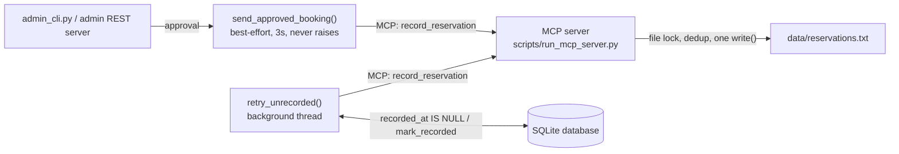
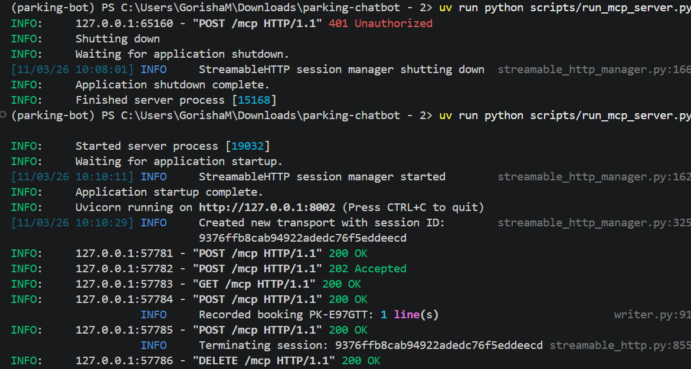
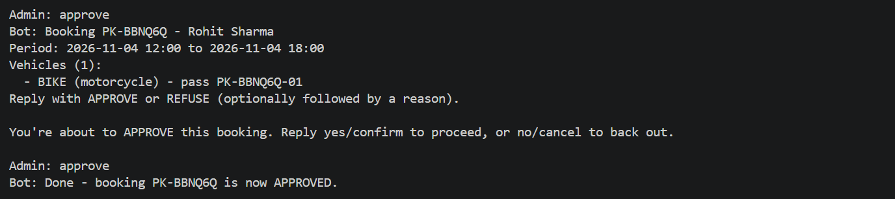
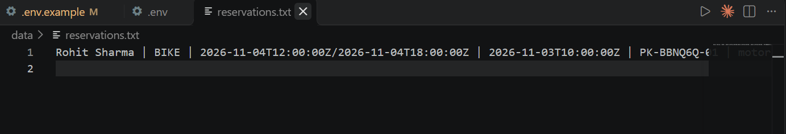
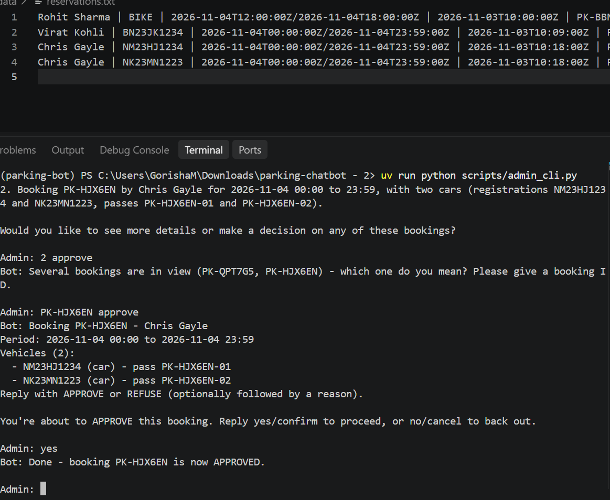
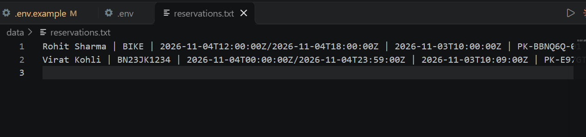
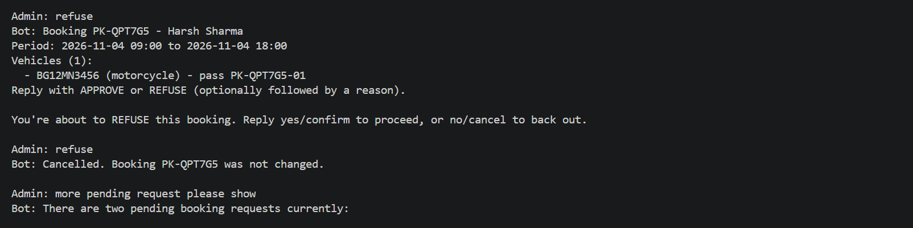
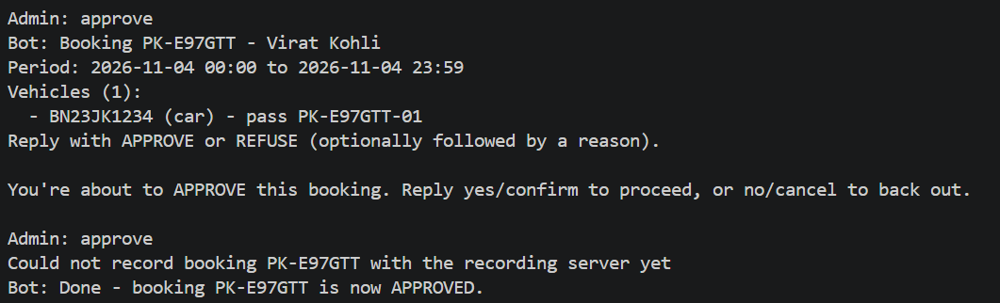
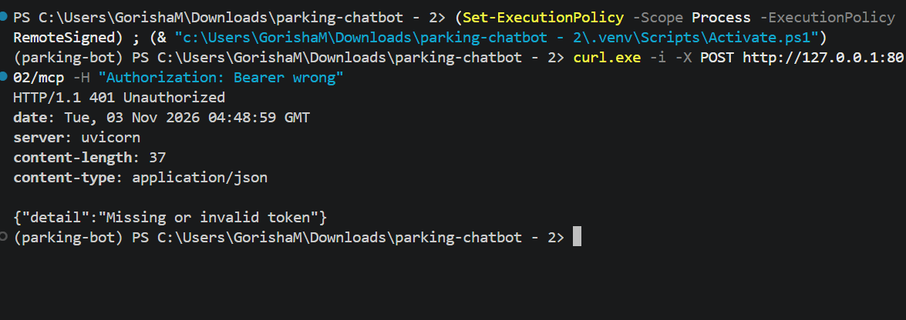
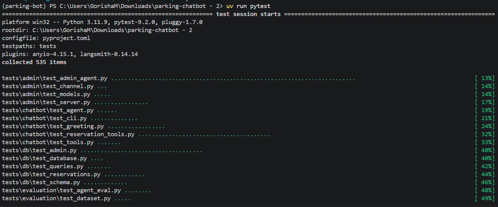

# CityPark Central: Stage 3 - Recording Approved Reservations via MCP

This document covers **Stage 3 only**: the MCP server that records every approved reservation to a text file, and the client-side integration that calls it.

## Contents

1. [Overview](#overview)
2. [Architecture](#architecture)
3. [The reservation file](#the-reservation-file)
4. [The MCP server](#the-mcp-server)
5. [The recording client](#the-recording-client)
6. [Setup](#setup)
7. [Usage](#usage)
8. [Security and privacy](#security-and-privacy)
9. [Testing](#testing)
10. [CI/CD](#cicd)
11. [Limitations](#limitations)

---

## Overview

When an administrator approves a booking (Stage 2), a standalone **MCP server** (`scripts/run_mcp_server.py`, streamable HTTP) appends it to a fixed text file, one line per vehicle.

Recording never blocks or fails an approval. The admin flow sends a best-effort notification right after approving, and a background sweep retries anything that did not get through, so an approval is never lost.

---

## Architecture



- **The hook** runs inside whichever program just saved the approval, with a short timeout and no retries.
- **The sweep** runs on a daemon thread in both `admin_cli.py` and `scripts/run_admin_server.py`: once at startup, then every `MCP_RETRY_INTERVAL_SECONDS`, for each approved booking whose `recorded_at` is still empty.
- **The MCP server is a separate process.** It never touches the database; it validates what the client sends and writes it to the file.
- **Only approved bookings are sent.** This is enforced client-side: `list_unrecorded_approved_bookings()` returns only `status = 'approved'` rows.

---

## The reservation file

One line per vehicle, appended to `MCP_RESERVATIONS_FILE_PATH` (default `data/reservations.txt`):

```
Name | Car Number | Reservation Period | Approval Time | Pass ID | Vehicle Type
```

- **UTC, ISO 8601.** Times are converted from the facility's local time (`FACILITY_TIMEZONE`) to UTC.
- **Whole-group atomicity.** All vehicle lines of a booking are written in a single `write()` call inside a file lock, never a partial group.
- **Dedup by booking ID.** Before writing, the file is checked for a line whose Pass ID starts with the booking ID, so a retried send writes nothing.
- **Crash recovery.** If the last line lacks a trailing newline (interrupted write), the next append starts on a new line.
- **Append-only.** The file is opened in append mode only.

---

## The MCP server

`parking_chatbot/recording/server.py`, run by `scripts/run_mcp_server.py` (default `http://127.0.0.1:8002`):

| Endpoint / tool | Auth | Purpose |
|---|---|---|
| `GET /health` | none | Liveness check |
| `POST /mcp` -> `record_reservation` | Bearer token | Validate and append one approved booking's vehicle lines |

---

## The recording client

`parking_chatbot/recording/client.py`, used by `admin_cli.py` and the admin REST server:

| Function | When it runs | Timeout | Retry |
|---|---|---|---|
| `send_approved_booking(booking_id)` | Right after an approval | 3s (fixed) | None; single attempt, never raises |
| `retry_unrecorded()` | At startup, then every `MCP_RETRY_INTERVAL_SECONDS` | `MCP_REQUEST_TIMEOUT_SECONDS` | A failing booking is retried on the next sweep |
| `start_retry_sweep_thread()` | Called once at startup by both admin entry points | - | Runs the sweep on a daemon thread |

`MCP_SERVER_URL` may be the bare origin or include `/mcp`; the client handles both.

---

## Setup

### Prerequisites

- Python 3.11+ and [`uv`](https://docs.astral.sh/uv/)
- The Stage 1/2 database (`data/parking.db`). Stage 3 reads approved bookings from it and adds a `recorded_at` column automatically on startup.

### Install

```bash
uv sync
cp .env.example .env        # Windows PowerShell: copy .env.example .env
```

### Configure `.env`

| Variable | Required | Notes |
|---|---|---|
| `MCP_API_TOKEN` | **yes** | At least 32 characters; unset or too short means the server will not start and the client will not send. Generate: `uv run python -c "import secrets; print(secrets.token_urlsafe(32))"` |
| `FACILITY_TIMEZONE` | no | IANA zone, e.g. `Europe/Berlin`. Default `UTC`. An unknown zone fails at startup. |
| `MCP_SERVER_URL` | no | Default `http://127.0.0.1:8002`. |
| `MCP_RESERVATIONS_FILE_PATH` | no | Default `data/reservations.txt`; relative paths resolve against the project root. |
| `MCP_RETRY_INTERVAL_SECONDS` | no | Default 30, minimum 5. |
| `MCP_REQUEST_TIMEOUT_SECONDS` | no | Default 5, minimum 1. |

---

## Usage

Run two terminals.

### 1. Start the MCP server

```bash
uv run python scripts/run_mcp_server.py
```



### 2. Start the admin console

```bash
uv run python scripts/admin_cli.py
```

(`scripts/run_admin_server.py` works the same way and also runs the retry sweep.)

### 3. Approve a single booking

Approve a pending booking in the admin console.



The server authenticates the request, writes the line, and logs it (booking ID and line count only):


The line appears in `data/reservations.txt`:



### 4. Approve a group booking

A group booking produces one line per vehicle, with the same name and approval time.





### 5. Refuse a booking

A refused booking never reaches the server, and the file does not change.



### 6. Server unavailable at approval time

If the MCP server is down, the approval is kept and `recorded_at` stays empty. The sweep logs a warning and retries.




---

## Security and privacy

- **Fails closed.** `MCP_API_TOKEN` unset, empty or under 32 characters stops the server before it binds a port, and the client refuses to send.
- **Constant-time token check** (`secrets.compare_digest`) in a small Starlette middleware. The token never appears in logs, errors or URLs. (The `mcp` SDK's OAuth support is not used: this is one shared secret between our own client and server.)
- **Local by default.** The server binds to `127.0.0.1` unless `MCP_SERVER_URL` is changed.
- **Input is rejected, never escaped.** A `|`, newline, control character, or Unicode line/paragraph separator (U+2028/U+2029) in any field rejects the whole group. Vehicle type and ISO 8601 dates are validated as well.
- **Fixed file path.** The location comes only from `MCP_RESERVATIONS_FILE_PATH`, resolved once at startup; no tool argument can influence it. The file is created owner read/write only.
- **Request size limit.** Requests declaring more than 64 KB in `Content-Length` get a 413.
- **No personal data in logs.** Logs contain booking IDs, line counts, rejected field names and exception type/message only.
- **No secrets in git.** `.env`, `data/parking.db` and `data/reservations.txt` (and its `.lock`) are gitignored; `.env.example` holds placeholders only.

Requests without a valid token are rejected:



---

## Testing

```bash
uv run pytest
```



All 535 tests pass locally and in a clean `python:3.11-slim` container using only the dummy CI environment variables. Stage 3 coverage includes:

- Field validation rules in `formatting.py` and the whole-group single-write guarantee.
- Dedup (including a retry with different data), crash-truncated last line recovery, and concurrent writes.
- The bearer-auth middleware, the 64 KB limit, and startup refusal without a valid token.
- The best-effort hook and the retry sweep, including its exception logging.
- The `recorded_at` migration and backfill (old approved bookings are not resent when the sweep starts), and `admin_cli.py` running the migration on startup.

---

## CI/CD

`.gitlab-ci.yml` (EPAM GitLab) runs `uv sync` then `uv run pytest --junitxml=report.xml` on a Python 3.11 image for every branch push and merge request. All variables are dummy placeholders (the `MCP_API_TOKEN` dummy is 36 characters, satisfying the 32-character minimum), and no test touches a real network, LLM or file outside a temporary path.


---

## Limitations

- **Approved-only is enforced by the client.** `record_reservation` cannot verify a booking's status itself and trusts its caller.
- **The 64 KB limit checks `Content-Length` only.** A request that misstates its length while streaming is not caught. Acceptable for a token-gated, local service; revisit if it is ever exposed publicly.
- **Legacy vehicles have `vehicle_type = NULL`** (from the pre-Stage-1 layout). Such bookings fail validation and will not be recorded until the data is corrected by hand.
- **The sweep runs only while its host process runs.** If neither the admin console nor the admin REST server is running while the MCP server is unreachable, recording pauses; nothing is lost.