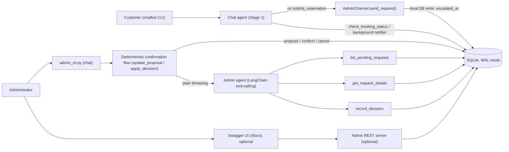

# CityPark Central: Stage 2 - Human-in-the-Loop Admin Approval

This document covers **Stage 2 only**: the human-in-the-loop part of the CityPark Central parking chatbot. For Stage 1 (the chatbot itself - RAG, reservation dialogue, guardrails, evaluation), see [`docs/README_stage1_backup.md`](docs/README_stage1_backup.md).

## Contents

1. [Overview](#overview)
2. [Architecture](#architecture)
3. [The reservation lifecycle](#the-reservation-lifecycle)
4. [The admin agent](#the-admin-agent)
5. [Setup](#setup)
6. [Usage](#usage)
7. [Project structure](#project-structure)
8. [Testing](#testing)
9. [CI/CD](#cicd)
10. [Security and privacy](#security-and-privacy)
11. [Limitations and next steps](#limitations-and-next-steps)

---

## Overview

Stage 1's chatbot collects reservation details from a customer but cannot decide on its own whether to accept a booking. Stage 2 adds a second, separate LangChain agent that lets a human administrator review and decide on every booking: the chatbot escalates a completed reservation as soon as it's submitted, the administrator approves or refuses it (by chatting with the admin agent, or over a REST API), and the customer-facing chatbot finds out and tells the customer - all without the two agents ever calling each other directly.

---

## Architecture



The chatbot and the administrator communicate **only through the database**, never directly:

1. **Escalation.** When the customer confirms a booking, `submit_reservation` (in the chatbot's tools) builds an `ApprovalRequest` and calls `AdminChannel.send_request()`. The real implementation, `DbAdminChannel`, just marks the booking's `escalated_at` column in SQLite - a local write, not a network call, so submitting a reservation never fails because nothing on the admin side happens to be running.
2. **Decision.** The administrator reviews pending bookings and decides, either by chatting with the admin agent (`admin_cli.py`) or through the optional REST server. Either way, the decision is written to the same `reservations` row (`status`, `decided_at`, `decision_reason`) through one shared function, `admin/agent.py::apply_decision()`.
3. **Notification.** The chatbot's CLI runs a background check for bookings submitted in the current conversation and tells the customer as soon as one is no longer `pending` - see [Limitations](#limitations-and-next-steps) for what "background" means here.

Three processes can have the SQLite database open at the same time (the chatbot, the admin console, the admin REST server). `db/database.py::get_connection()` sets WAL journal mode and an explicit busy timeout so they can read and write concurrently without one blocking another into a "database is locked" error.

---

## The reservation lifecycle

A booking's `status` column moves through exactly these values:

| Status | Meaning |
|---|---|
| `pending` | Submitted, escalated, waiting for a decision |
| `approved` | An administrator approved it |
| `refused` | An administrator refused it (with an optional reason) |
| `expired` | No decision was made within `ADMIN_REQUEST_EXPIRY_MINUTES` (default 60) |

- **Unique IDs.** Each booking gets a random `booking_id` (`PK-XXXXXX`), and each vehicle in it a `pass_id` derived from that (`PK-XXXXXX-01`, `-02`, ...). A group booking (several vehicles, one booker, one period) is decided on as a single unit - there is no per-vehicle approval.
- **One decision per request.** Deciding is one atomic database transaction (`db/admin.py::record_decision`, wrapped in `BEGIN IMMEDIATE`); a second decision on an already-decided booking raises `AlreadyDecidedError` and changes nothing. The one exception is a **repeated identical** decision (e.g. a retried call) - `apply_decision()` treats that as success, not a conflict, so retrying never 409s or writes twice.
- **Expiry is lazy.** There is no background scheduler. Every read that touches a booking (`list_pending_bookings`, `get_booking`, `get_pending_request`, `record_decision`) first flips any `pending` booking past its expiry window to `expired`, comparing against `created_at` in UTC.

---

## The admin agent

`admin/agent.py` is a second LangChain tool-calling agent (`create_agent`, the same way the chatbot's agent is built), with its own system prompt and three tools:

| Tool | Purpose |
|---|---|
| `list_pending_requests` | List every booking currently awaiting a decision, with a short summary |
| `get_request_details(booking_id)` | Show one booking's full details (booker, period, every vehicle) |
| `record_decision(booking_id, decision, reason)` | Record a decision - a defense-in-depth fallback, see below |

**The confirmation step is deterministic code, not the LLM.** Before the agent is even invoked, `admin_chat()` runs the administrator's raw message through `update_proposal()`:

- A message naming a booking ID with a clear decision ("approve PK-X", "refuse PK-X, no space") creates a *proposal* and shows the full booking details, asking for an explicit yes/confirm or no/cancel - **nothing is written yet**.
- A bare yes/confirm, with a proposal pending, writes exactly that stored proposal.
- A bare no/cancel clears it.
- Naming a different booking ID or decision replaces whatever was pending.
- Anything ambiguous or negated ("PK-X, not sure", "don't approve PK-X") is left as-is and the administrator is asked to state it plainly - **it is never treated as an approval**.
- Only a message with no booking ID and no proposal pending (browsing, open-ended conversation) reaches the LLM agent at all.

**Safety design:**
- The `record_decision` tool's schema has **no `admin_message` argument** - the LLM cannot supply or forge the text a decision gets checked against. The tool reads the administrator's actual latest input from a plain per-conversation store that only the CLI's own input loop writes to (`record_admin_message`), independently re-derives the decision from it (`interpret_reply`), and refuses to write if that doesn't match what the tool call claims.
- `interpret_reply`'s LLM fallback (used only for genuinely unclear free text reaching the REST API) has a structured-output schema where `"approved"` is not a legal value - the model can only conclude `"refused"` or `"unclear"`. **Ambiguity can never resolve to an approval.**
- Negated phrasing ("do not approve", "never confirm this") is caught by a dedicated check before the plain keyword match, so it is never misread as a plain approval.

---

## Setup

### Prerequisites

- Python 3.11+ and [`uv`](https://docs.astral.sh/uv/)
- Access to an EPAM DIAL endpoint with a chat deployment (used by the chatbot, and by the admin agent's LLM fallback for genuinely unclear replies - the deterministic approve/refuse flow itself needs no network access)

### Install

```bash
uv sync
cp .env.example .env        # Windows PowerShell: copy .env.example .env
```

`uv sync` also installs the `en_core_web_lg` spaCy model Presidio needs for PII detection - it's declared as a direct wheel-URL dependency in `pyproject.toml`, so there is no separate download step.

### Configure `.env`

| Variable | Required | Notes |
|---|---|---|
| `DIAL_ENDPOINT`, `DIAL_API_KEY`, `DIAL_API_VERSION`, `CHAT_MODEL`, `EMBEDDING_MODEL` | yes | Stage 1 - no working default |
| `ADMIN_API_TOKEN` | yes, to use the admin REST server | No default: if unset, every REST request is rejected (fail closed). Generate one with `uv run python -c "import secrets; print(secrets.token_urlsafe(32))"`. Not needed just to run the chatbot or `admin_cli.py`. |
| `MAX_ADVANCE_DAYS` | optional | How many days ahead a reservation may start (default 90) |
| `MAX_VEHICLES_PER_BOOKING` | optional | Largest group booking (default 10) |
| `ADMIN_REQUEST_EXPIRY_MINUTES` | optional | See [lifecycle](#the-reservation-lifecycle) above (default 60) |
| `ADMIN_NOTIFY_POLL_SECONDS` | optional | How often the chatbot checks for a decision in the background (default 3) |
| `ADMIN_SERVER_URL` | optional | Where the admin REST server listens (default `http://127.0.0.1:8001`). **Currently unused**: `admin_cli.py` talks to the admin agent directly, not over HTTP. |
| `SQL_BUSY_TIMEOUT_MS` | optional | How long a DB connection waits for a lock before giving up (default 5000) |

`.env.example` lists every one of these with a comment; leave the optional ones commented out to use their default (an uncommented `VAR=` with nothing after it is read as an empty string, not "use the default," and will break the ones parsed with `int()`).

### Set up the data (shared with Stage 1 - both are prerequisites for Stage 2 to work at all)

```bash
uv run python scripts/seed_db.py     # SQL tables + demo hours/prices/availability
uv run python scripts/ingest.py      # chunk data/static/*.md into the vector store
```

Both are idempotent and safe to re-run - re-running `seed_db.py` against the real database just now (to verify this) changed the file's bytes (SQLite's internal layout after a delete+reinsert) but not its row counts or its existing reservations.

---

## Usage

Two terminals: the chatbot, and the admin console. Neither needs the other running.

```bash
# Terminal 1
uv run parking-bot

# Terminal 2
uv run python scripts/admin_cli.py
```

### Example: a booking, an approval, and the notification

```
# Terminal 1 (customer)
You: book a space for tomorrow 9 to 12, Anna Smith, car AB123CD
Bot: Your booking PK-EKSG9Z is submitted and pending administrator approval...

# Terminal 2 (administrator)
Admin: approve PK-EKSG9Z, looks fine
Bot: Booking PK-EKSG9Z - Anna Smith
     Period: 2026-11-20 09:00 to 2026-11-20 12:00
     Vehicles (1):
       - AB123CD (car) - pass PK-EKSG9Z-01
     Reply with APPROVE or REFUSE (optionally followed by a reason).

     You're about to APPROVE this booking (reason: looks fine). Reply yes/confirm to proceed, or no/cancel to back out.
Admin: yes
Bot: Done - booking PK-EKSG9Z is now APPROVED.

# Terminal 1 (moments later, unprompted)
Bot: Congrats! Your booking PK-EKSG9Z has been approved.
```

The administrator's lines (propose/confirm/write) and the customer's background notification were each verified against a real temporary database while writing this document - as two separate runs, not literally side by side in two terminals at once.

### Example: a refusal

A different booking - `PK-EKSG9Z` above is already decided, and a second decision on it would be rejected (see [lifecycle](#the-reservation-lifecycle)):

```
Admin: refuse PK-7K3Q9X, no space that day
Bot: ...You're about to REFUSE this booking (reason: no space that day). Reply yes/confirm to proceed, or no/cancel to back out.
Admin: yes
Bot: Done - booking PK-7K3Q9X is now REFUSED.
```

The customer's chatbot will report this as refused, with the reason, either automatically (the same background notification) or if asked directly ("is PK-7K3Q9X approved?").

### The admin REST server (optional)

For Swagger UI or scripted access - not needed to use `admin_cli.py`:

```bash
uv run python scripts/run_admin_server.py   # http://127.0.0.1:8001
```

| Endpoint | Auth | Purpose |
|---|---|---|
| `GET /health` | none | Liveness check |
| `GET /requests` | Bearer token | List pending bookings |
| `POST /requests/{booking_id}/decision` | Bearer token | `{"reply": "approve, looks fine"}` - free text, interpreted the same way as above |
| `GET /docs` | - | Swagger UI; click **Authorize** and paste the token |

Every endpoint but `/health` requires `Authorization: Bearer <ADMIN_API_TOKEN>`, checked in constant time. Verified just now: `GET /health` returns `200` with no token; `GET /requests` returns `401` with no token.

---

## Project structure

Stage 2 files only:

```
parking_chatbot/
  admin/
    models.py      ApprovalRequest / AdminDecision - the message contract
    channel.py      AdminChannel protocol; DbAdminChannel (real) and FakeAdminChannel (test)
    agent.py         the admin agent: tools, system prompt, the deterministic
                      confirmation flow, and the one shared write path
    server.py          the optional REST API (FastAPI), reusing that same write path
  db/
    admin.py        pending bookings, status/detail lookup, recording a decision
    database.py      connection helper - WAL mode, busy timeout
    schema.py         adds escalated_at / decided_at / decision_reason, migrates safely
  chatbot/
    reservation_tools.py   submit_reservation escalates; check_booking_status and the
                            background notifier read decisions back
    cli.py                   the chatbot's background decision-notification thread
  config.py          the ADMIN_*/SQL_BUSY_TIMEOUT_MS settings
scripts/
  run_admin_server.py   start the admin REST API
  admin_cli.py            conversational console for the administrator
tests/
  admin/, db/test_admin.py, db/test_database.py, db/test_schema.py (admin columns),
  chatbot/test_reservation_tools.py, chatbot/test_cli.py, scripts/test_admin_cli.py,
  scripts/test_run_admin_server.py, test_config.py (ADMIN_*/SQL_BUSY_TIMEOUT_MS)
```

---

## Testing

```bash
uv run pytest
```

**388 tests pass**, verified just now both locally and in a clean `python:3.11-slim` Docker container built from a pristine checkout (no `.venv`, no `data/parking.db`, no `.env` - only the dummy environment variables CI uses). No test needs real credentials: the LLM, the vector store, and HTTP calls are all replaced with fakes, and every test that touches the database gets its own temporary SQLite file via an **autouse** fixture in `tests/conftest.py` - no test can read or write the real `data/parking.db`, even one that doesn't explicitly ask for the database.

Stage 2 coverage includes: escalation and the shared write path, the deterministic confirmation flow (propose/confirm/cancel/replace, ambiguous and negated text, a forged tool-call argument being ignored in favor of the administrator's real message), idempotent and conflicting repeated decisions, expiry, the REST API's auth and error responses, the admin agent's tool-calling wiring, and the chatbot's background notifier.

---

## CI/CD

`.gitlab-ci.yml` runs on EPAM GitLab: a Python 3.11 image, `uv sync`, then `uv run pytest --junitxml=report.xml`, on every branch push and merge request, with only dummy `DIAL_*`/`CHAT_MODEL`/`EMBEDDING_MODEL` values (no real credentials) and a cached `uv` environment.

**Honest status:** a pipeline run on the `stage-2` branch (commit `0d2838e3`) failed - 2 of 379 tests, both reaching the real database path by accident because they didn't request the test database fixture. That bug and its root cause (no autouse isolation in `tests/conftest.py`) are fixed as described above, verified locally and in a clean container, but **this fix has not yet been pushed**, so I cannot yet point to a green GitLab run of this exact code. The pipeline is green only if the next run, after these changes are pushed, is.

---

## Security and privacy

- **Auth fails closed.** If `ADMIN_API_TOKEN` isn't configured, every REST request is rejected rather than left open.
- **No secrets in code or git.** `.env`, `data/parking.db`, and `data/*.bak` are gitignored and were confirmed (via `git ls-files`) to be untracked; `.env.example` holds placeholders only.
- **Personal data isn't logged.** The only `logger.*` calls in the admin/chatbot/db code log a guardrail category label (e.g. `"pii:EMAIL_ADDRESS"`), never raw text or PII values.
- **Minimal disclosure.** `check_booking_status` (the one tool that can look up a booking by ID from the customer side) returns only the bare status and decision reason for the exact ID given - never a name, plate, or other detail, even for an ID that isn't the asking customer's own.

---

## Limitations and next steps

- **Cancelling a submitted booking is not supported.** The chatbot refuses any request to cancel, change, or modify a booking that already has an ID, and points the customer to the facility's real contact details instead.
- **The notification is only as alive as the chatbot process.** It's a background thread inside the running `parking-bot` session, polling the database - it tells the customer about a decision only while that terminal session is open; it is not a push notification to an absent user.
- **An uninitialized database fails with a generic error, not a friendly one.** If `seed_db.py` has never been run, any tool that touches the `reservations` table (on either side) raises a plain `sqlite3.OperationalError`, caught generically by the CLI's own error handling rather than given a specific "the database hasn't been set up" message. This is unchanged from Stage 1's existing error-handling pattern and was a deliberate choice, not an oversight, when fixing the test gap above - changing it is a separate decision.
- **`ADMIN_SERVER_URL` is currently dead configuration** - nothing reads it, since `admin_cli.py` talks to the admin agent in-process rather than over HTTP.
- Stage 3 (an MCP server that writes approved reservations to a file) and Stage 4 (full LangGraph orchestration) are **not** part of this document.
