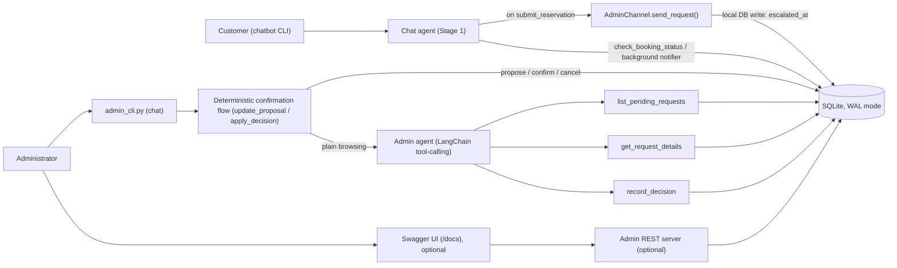
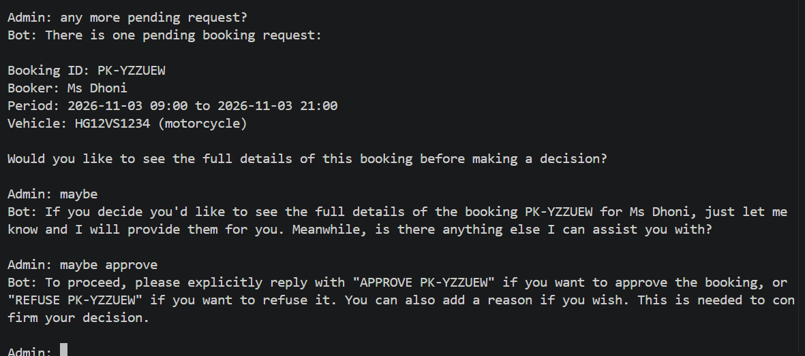
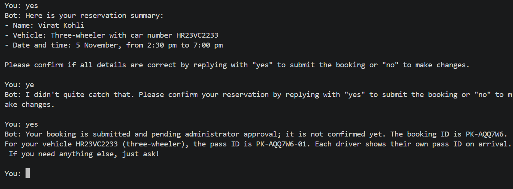
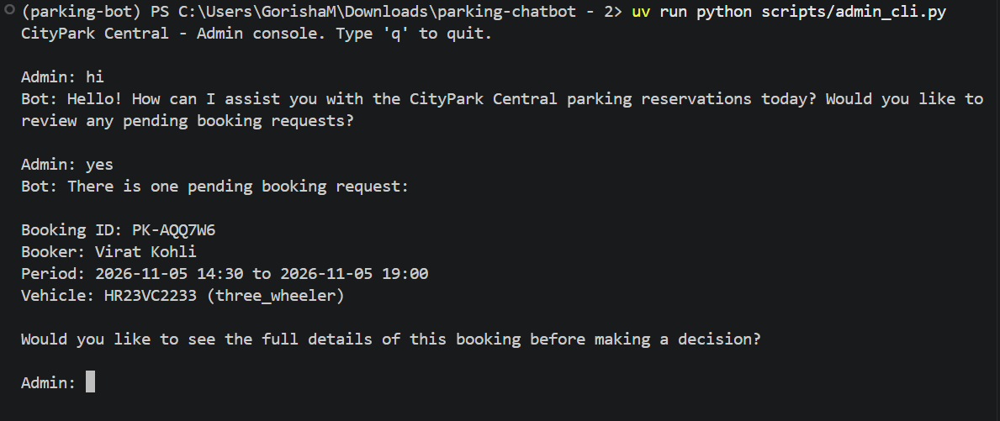
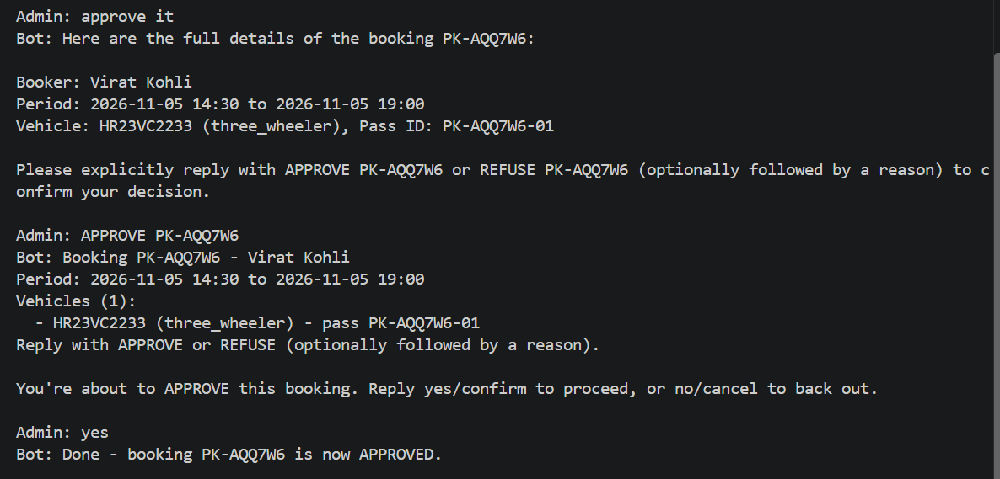
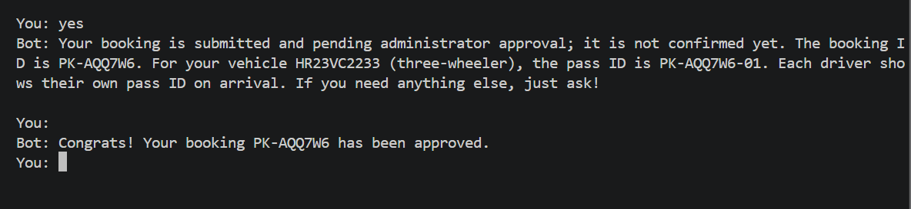
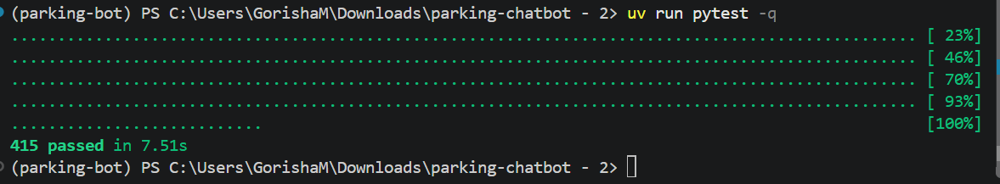
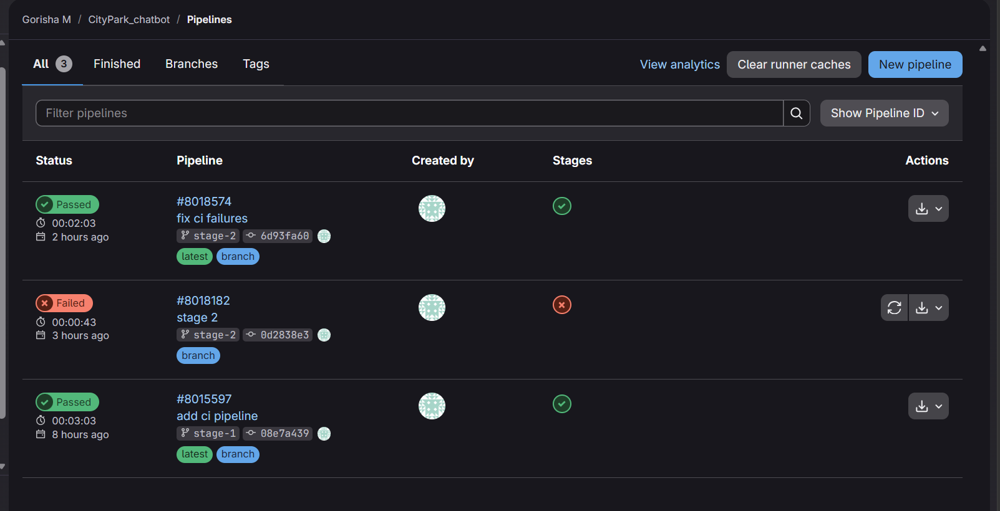
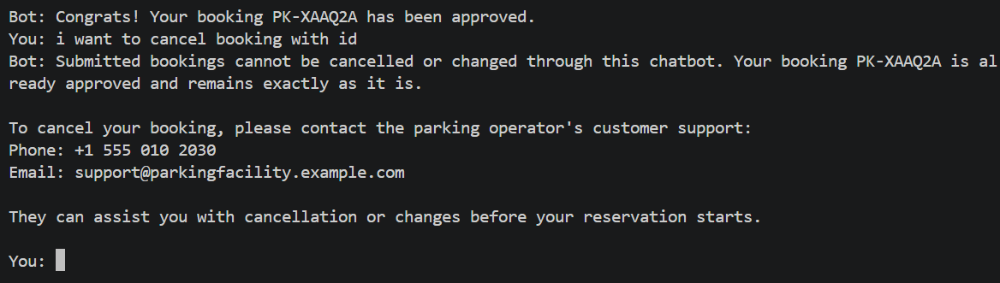

# CityPark Central: Stage 2 - Human-in-the-Loop Admin Approval

This document covers **Stage 2 only**: the human-in-the-loop part of the CityPark Central parking chatbot. 

## Contents

1. [Overview](#overview)
2. [Architecture](#architecture)
3. [The reservation lifecycle](#the-reservation-lifecycle)
4. [The admin agent](#the-admin-agent)
5. [Setup](#setup)
6. [Usage](#usage)
7. [Project structure](#project-structure)
8. [Testing](#testing)
9. [CI/CD](#cicd)
10. [Security and privacy](#security-and-privacy)
11. [Limitations and next steps](#limitations-and-next-steps)

---

## Overview

Stage 1's chatbot collects reservation details from a customer but cannot decide on its own whether to accept a booking. Stage 2 adds a second, separate LangChain agent that lets a human administrator review and decide on every booking: the chatbot escalates a completed reservation as soon as it's submitted, the administrator approves or refuses it (by chatting with the admin agent, or over a REST API), and the customer-facing chatbot finds out and tells the customer - all without the two agents ever calling each other directly.

---

## Architecture



The chatbot and the administrator communicate **only through the database**, never directly:

1. **Escalation.** When the customer confirms a booking, `submit_reservation` (in the chatbot's tools) builds an `ApprovalRequest` and calls `AdminChannel.send_request()`. The real implementation, `DbAdminChannel`, just marks the booking's `escalated_at` column in SQLite - a local write, not a network call, so submitting a reservation never fails because nothing on the admin side happens to be running.
2. **Decision.** The administrator reviews pending bookings and decides, either by chatting with the admin agent (`admin_cli.py`) or through the optional REST server. Either way, the decision is written to the same `reservations` row (`status`, `decided_at`, `decision_reason`) through one shared function, `admin/agent.py::apply_decision()`.
3. **Notification.** The chatbot's CLI runs a background check for bookings submitted in the current conversation and tells the customer as soon as one is no longer `pending` - see [Limitations](#limitations-and-next-steps) for what "background" means here.

Three processes can have the SQLite database open at the same time (the chatbot, the admin console, the admin REST server). `db/database.py::get_connection()` sets WAL journal mode and an explicit busy timeout so they can read and write concurrently without one blocking another into a "database is locked" error.

---

## The reservation lifecycle

A booking's `status` column moves through exactly these values:

| Status | Meaning |
|---|---|
| `pending` | Submitted, escalated, waiting for a decision |
| `approved` | An administrator approved it |
| `refused` | An administrator refused it (with an optional reason) |
| `expired` | No decision was made within `ADMIN_REQUEST_EXPIRY_MINUTES` (default 60) |

- **Unique IDs.** Each booking gets a random `booking_id` (`PK-XXXXXX`), and each vehicle in it a `pass_id` derived from that (`PK-XXXXXX-01`, `-02`, ...). A group booking (several vehicles, one booker, one period) is decided on as a single unit - there is no per-vehicle approval.
- **One decision per request.** Deciding is one atomic database transaction (`db/admin.py::record_decision`, wrapped in `BEGIN IMMEDIATE`); a second decision on an already-decided booking raises `AlreadyDecidedError` and changes nothing. The one exception is a **repeated identical** decision (e.g. a retried call) - `apply_decision()` treats that as success, not a conflict, so retrying never 409s or writes twice.
- **Expiry is lazy.** There is no background scheduler. Every read that touches a booking (`list_pending_bookings`, `get_booking`, `get_pending_request`, `record_decision`) first flips any `pending` booking past its expiry window to `expired`, comparing against `created_at` in UTC.

---

## The admin agent

`admin/agent.py` is a second LangChain tool-calling agent (`create_agent`, the same way the chatbot's agent is built), with its own system prompt and four tools:

| Tool | Purpose |
|---|---|
| `list_pending_requests` | List every booking currently awaiting a decision, with a short summary |
| `get_request_details(booking_id)` | Show one *pending* booking's full details (booker, period, every vehicle) |
| `get_booking_status(booking_id)` | The REAL, current status of **any** booking - pending, approved, refused or expired - straight from the database, with `decided_at`, `decision_reason` and full details. Always used for status questions; never answered from memory. |
| `record_decision(booking_id, decision, reason)` | Record a decision - a defense-in-depth fallback, see below |

**The confirmation step is deterministic code, not the LLM.** Before the agent is even invoked, `admin_chat()` runs the administrator's raw message through `update_proposal()`:

- **A status question is never a decision.** "is PK-X approved?", "has PK-X been refused yet?" contain the words "approved"/"refused", which also match the decision keywords - a check for question phrasing (leading "is/was/has/...", or a trailing "?") catches these first and always defers to the agent (which calls `get_booking_status`), so a question can never create, confirm, or silently complete a decision. A proposal already waiting for yes/no is left untouched if the administrator asks an unrelated question in between.
- A message naming a booking ID with a clear decision ("approve PK-X", "refuse PK-X, no space") creates a *proposal* and shows the full booking details, asking for an explicit yes/confirm or no/cancel - **nothing is written yet**.
- **"Approve it" / "refuse, dates clash"** (a decision with no booking ID) resolves against whatever booking(s) are currently "in view" for this conversation - set by the last `list_pending_requests`, `get_request_details` or `get_booking_status` call, or by naming an ID explicitly. Exactly one in view → that one; none → asked for an ID; more than one → asked which.
- A bare yes/confirm, with a proposal pending, writes exactly that stored proposal (not a fresh reading of the word "yes" itself, so confirming a stored *refusal* can't be misread as an approval).
- A bare no/cancel clears it.
- Naming a different booking ID or decision replaces whatever was pending.
- Anything ambiguous or negated ("PK-X, not sure", "don't approve PK-X", "maybe") is left as-is and the administrator is asked to state it plainly - **it is never treated as an approval**.
- Only a message with no booking ID, no usable context, and no proposal pending (browsing, open-ended conversation) reaches the LLM agent at all.

**Status questions and "already decided" never come from memory.** The system prompt requires the agent to call `get_booking_status` for any status question, or whenever the administrator says they already decided something, and answer strictly from its result - stating plainly if a booking is already approved, refused or expired (with when, and the reason if refused) and stopping there, rather than asking the administrator to repeat a decision based on what the conversation *seemed* to say earlier. This was a real bug: the agent had told an administrator that an already-decided booking was "still pending" and that "the system has not recorded the approval yet," purely from stale conversation context.

**Distinct, specific errors.** `record_decision` and the REST API's decision endpoint share one write path (`interpret_and_apply`/`apply_decision`) and report five *distinct* failure reasons, each relayed to the administrator in plain words: unknown booking ID, already decided (which decision, and when - `AlreadyDecidedError` now carries `decided_at`/`decision_reason`), expired (a separate `ExpiredBookingError` - nobody decided, as opposed to someone already having decided), an ambiguous message, and a mismatch between the claimed decision and what the administrator's real message says.

**Safety design:**
- The `record_decision` tool's schema has **no `admin_message` argument** - the LLM cannot supply or forge the text a decision gets checked against. The tool reads the administrator's actual latest input from a plain per-conversation store that only the CLI's own input loop writes to (`record_admin_message`), independently re-derives the decision from it (`interpret_reply`), and refuses to write if that doesn't match what the tool call claims.
- `interpret_reply`'s LLM fallback (used only for genuinely unclear free text reaching the REST API) has a structured-output schema where `"approved"` is not a legal value - the model can only conclude `"refused"` or `"unclear"`. **Ambiguity can never resolve to an approval.**
- Negated phrasing ("do not approve", "never confirm this") is caught by a dedicated check before the plain keyword match, so it is never misread as a plain approval.

### Safety in action: an unclear reply never approves

When the administrator types something vague like "maybe", the agent does not guess: it asks for a clear approve or refuse, and nothing is written to the database.



---

## Setup

### Prerequisites

- Python 3.11+ and [`uv`](https://docs.astral.sh/uv/)
- Access to an EPAM DIAL endpoint with a chat deployment (used by the chatbot, and by the admin agent's LLM fallback for genuinely unclear replies - the deterministic approve/refuse flow itself needs no network access)

### Install

```bash
uv sync
cp .env.example .env        # Windows PowerShell: copy .env.example .env
```

`uv sync` also installs the `en_core_web_lg` spaCy model Presidio needs for PII detection - it's declared as a direct wheel-URL dependency in `pyproject.toml`, so there is no separate download step.

### Configure `.env`

| Variable | Required | Notes |
|---|---|---|
| `DIAL_ENDPOINT`, `DIAL_API_KEY`, `DIAL_API_VERSION`, `CHAT_MODEL`, `EMBEDDING_MODEL` | yes | Stage 1 - no working default |
| `ADMIN_API_TOKEN` | yes, to use the admin REST server | No default: if unset, every REST request is rejected (fail closed). Generate one with `uv run python -c "import secrets; print(secrets.token_urlsafe(32))"`. Not needed just to run the chatbot or `admin_cli.py`. |
| `MAX_ADVANCE_DAYS` | optional | How many days ahead a reservation may start (default 90) |
| `MAX_VEHICLES_PER_BOOKING` | optional | Largest group booking (default 10) |
| `ADMIN_REQUEST_EXPIRY_MINUTES` | optional | See [lifecycle](#the-reservation-lifecycle) above (default 60) |
| `ADMIN_NOTIFY_POLL_SECONDS` | optional | How often the chatbot checks for a decision in the background (default 3) |
| `ADMIN_SERVER_URL` | optional | Where the admin REST server listens (default `http://127.0.0.1:8001`). **Currently unused**: `admin_cli.py` talks to the admin agent directly, not over HTTP. |
| `SQL_BUSY_TIMEOUT_MS` | optional | How long a DB connection waits for a lock before giving up (default 5000) |

`.env.example` lists every one of these with a comment; leave the optional ones commented out to use their default (an uncommented `VAR=` with nothing after it is read as an empty string, not "use the default," and will break the ones parsed with `int()`).

### Set up the data (shared with Stage 1 - both are prerequisites for Stage 2 to work at all)

```bash
uv run python scripts/seed_db.py     # SQL tables + demo hours/prices/availability
uv run python scripts/ingest.py      # chunk data/static/*.md into the vector store
```

Both are idempotent and safe to re-run - re-running `seed_db.py` against the real database just now (to verify this) changed the file's bytes (SQLite's internal layout after a delete+reinsert) but not its row counts or its existing reservations.

---

## Usage

Two terminals: the chatbot, and the admin console. Neither needs the other running.

```bash
# Terminal 1
uv run parking-bot

# Terminal 2
uv run python scripts/admin_cli.py
```

### Example: a booking, an approval, and the notification

The walkthrough below follows one booking from submission to the customer's notification.

#### 1. The customer submits a booking

The customer gives the details and confirms. The chatbot replies with the booking ID and tells them it is pending administrator approval.



#### 2. The administrator sees it in the pending list

In the admin console, asking "what's pending?" lists the new request with its details.



#### 3. The administrator asks to approve - and is asked to confirm

Saying "approve it" does **not** write anything. The deterministic confirmation flow shows the full booking details and asks for an explicit yes/confirm or no/cancel. This is the human-in-the-loop safety step.



#### 4. The decision is recorded and the customer is notified

Once the administrator confirms, the decision is written and the agent reports the booking as approved. A moment later, without the customer asking, the chatbot tells them. The screenshot shows both terminals side by side, which is where the two agents' database-only communication becomes visible.




### The admin REST server (optional)

For Swagger UI or scripted access - not needed to use `admin_cli.py`:

```bash
uv run python scripts/run_admin_server.py   # http://127.0.0.1:8001
```

| Endpoint | Auth | Purpose |
|---|---|---|
| `GET /health` | none | Liveness check |
| `GET /requests` | Bearer token | List pending bookings |
| `POST /requests/{booking_id}/decision` | Bearer token | `{"reply": "approve, looks fine"}` - free text, interpreted the same way as above |
| `GET /docs` | - | Swagger UI; click **Authorize** and paste the token |

Every endpoint but `/health` requires `Authorization: Bearer <ADMIN_API_TOKEN>`, checked in constant time. Verified just now: `GET /health` returns `200` with no token; `GET /requests` returns `401` with no token.

---

## Testing

```bash
uv run pytest
```

**415 tests pass** locally as of the admin agent fixes described above (status questions, `get_booking_status`, distinct errors, "approve it"). No test needs real credentials: the LLM, the vector store, and HTTP calls are all replaced with fakes, and every test that touches the database gets its own temporary SQLite file via an **autouse** fixture in `tests/conftest.py` - no test can read or write the real `data/parking.db`, even one that doesn't explicitly ask for the database.



Stage 2 coverage includes: escalation and the shared write path, the deterministic confirmation flow (propose/confirm/cancel/replace/"approve it", ambiguous and negated text, status questions never being read as decisions, a forged tool-call argument being ignored in favor of the administrator's real message), idempotent and conflicting repeated decisions, expiry, the REST API's auth and error responses, the admin agent's tool-calling wiring, and the chatbot's background notifier.

---

## CI/CD

`.gitlab-ci.yml` runs on EPAM GitLab: a Python 3.11 image, `uv sync`, then `uv run pytest --junitxml=report.xml`, on every branch push and merge request, with only dummy `DIAL_*`/`CHAT_MODEL`/`EMBEDDING_MODEL` values (no real credentials) and a cached `uv` environment.



**Honest status:** an earlier pipeline run on the `stage-2` branch (commit `0d2838e3`) failed - 2 of 379 tests reaching the real database path by accident. That was fixed, committed (`6d93fa6`) and pushed. The admin-agent fixes described in this document (on top of that commit) are new, uncommitted, and verified locally only - a clean-container rebuild from a pristine checkout, the same way the previous fix was verified, was attempted but could not complete this round (Docker Desktop's engine was not running on the machine). The pipeline is green for *this* code only once it has actually been pushed and run.

---

## Security and privacy

- **Auth fails closed.** If `ADMIN_API_TOKEN` isn't configured, every REST request is rejected rather than left open.
- **No secrets in code or git.** `.env`, `data/parking.db`, and `data/*.bak` are gitignored and were confirmed (via `git ls-files`) to be untracked; `.env.example` holds placeholders only.
- **Personal data isn't logged.** The only `logger.*` calls in the admin/chatbot/db code log a guardrail category label (e.g. `"pii:EMAIL_ADDRESS"`), never raw text or PII values.
- **Minimal disclosure.** `check_booking_status` (the one tool that can look up a booking by ID from the customer side) returns only the bare status and decision reason for the exact ID given - never a name, plate, or other detail, even for an ID that isn't the asking customer's own (see the [status check screenshot](#example-checking-a-bookings-status)).

---

## Limitations and next steps

- **Cancelling a submitted booking is not supported.** The chatbot refuses any request to cancel, change, or modify a booking that already has an ID, and points the customer to the facility's real contact details instead.

  

- **The notification is only as alive as the chatbot process.** It's a background thread inside the running `parking-bot` session, polling the database - it tells the customer about a decision only while that terminal session is open; it is not a push notification to an absent user.
- **An uninitialized database fails with a generic error, not a friendly one.** If `seed_db.py` has never been run, any tool that touches the `reservations` table (on either side) raises a plain `sqlite3.OperationalError`, caught generically by the CLI's own error handling rather than given a specific "the database hasn't been set up" message. This is unchanged from Stage 1's existing error-handling pattern and was a deliberate choice, not an oversight, when fixing the test gap above - changing it is a separate decision.
- **`ADMIN_SERVER_URL` is currently dead configuration** - nothing reads it, since `admin_cli.py` talks to the admin agent in-process rather than over HTTP.
- Stage 3 (an MCP server that writes approved reservations to a file) and Stage 4 (full LangGraph orchestration) are **not** part of this document.