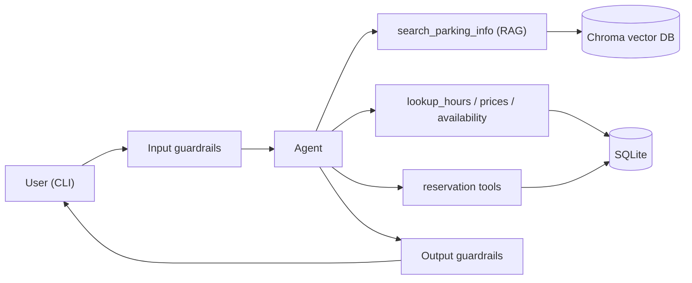

# CityPark Central: Parking Reservation Chatbot (CLI)

A command-line chatbot for the CityPark Central parking facility. It answers questions using Retrieval-Augmented Generation (RAG), reads live data (opening hours, prices, free spaces) from a SQL database, collects reservation details through a validated dialogue, and applies guardrails so sensitive data never reaches the user.

It works with **any LLM and any embedding model** supported by LangChain: OpenAI, Azure OpenAI, Anthropic, Google, Ollama, or any OpenAI-compatible endpoint (EPAM DIAL, OpenRouter, vLLM, LM Studio and others). You only change configuration, not code.


---

## Contents

1. [Features](#features)
2. [Architecture](#architecture)
3. [Quick start](#quick-start)
4. [Configuration](#configuration)
5. [Usage walkthrough](#usage-walkthrough)
6. [Design details](#design-details)
7. [Testing](#testing)
8. [Evaluation](#evaluation)
9. [Project structure](#project-structure)
10. [Known limitations](#known-limitations)

---

## Features

- **Information answers (RAG):** general info, location, facilities, allowed vehicles, rules, payment, contacts, FAQ and the booking process, answered from documents in a Chroma vector database.
- **Live data (SQL):** working hours, prices per vehicle type, and free spaces come from SQLite, never from embeddings.
- **Reservation dialogue:** collects first name, last name, car number, vehicle type and reservation period, validates each value, and supports corrections, cancelling and group bookings.
- **Guardrails:** blocks prompt injection and fishing for other customers' data, and detects and masks sensitive data in both directions using a pretrained NER model (Presidio).
- **Evaluation:** Precision@K, Recall@K, latency (mean, p95, max), tool-routing accuracy and honesty on unanswerable questions, reproducible from one command.
- **Provider-agnostic:** swap the chat or embedding model through environment variables.

---

## Architecture



The agent routes each question to the right tool and calls several tools when a question mixes static and dynamic information.

### Data split: static vs dynamic

| Data | Store | Why |
|---|---|---|
| General info, location, facilities, allowed vehicles, rules, payment, contacts, FAQ, booking process (`data/static/*.md`) | **Chroma** vector DB | Free text, rarely changes, needs semantic search |
| Working hours, prices (per vehicle type and plan), free spaces | **SQLite** (`data/parking.db`) | Structured, changes often, must be exact; never answered from embeddings |

Prices depend on vehicle type, because bigger vehicles take more space: `motorcycle` (two-wheelers) < `three_wheeler` < `car` (cars and SUVs) < `van` (small vans and minibuses up to 2.1 m). Demo prices are defined in `scripts/seed_db.py`.

---

## Quick start

### Requirements

- Python 3.11+
- [`uv`](https://docs.astral.sh/uv/) for dependency management
- An API key for **any** supported chat model and embedding model (or a local model server such as Ollama)

### Install

```bash
# 1. Install dependencies (creates .venv)
uv sync

# 2. Create your configuration
cp .env.example .env        # Windows PowerShell: copy .env.example .env
#    then edit .env (see Configuration below)
```

### Load the data

Both steps are idempotent and safe to re-run.

```bash
# Create SQL tables and load demo hours / prices / availability.
# Existing reservations are kept, and a database from an older version
# is upgraded in place.
uv run python scripts/seed_db.py

# Chunk the static docs in data/static/, embed them and store them in Chroma
uv run python scripts/ingest.py
```


To inspect what was stored (SQL tables, and Chroma collection with sample chunks):


### Run the chatbot

```bash
uv run parking-bot            # or: uv run python -m parking_chatbot.chatbot.cli
uv run parking-bot --debug    # also shows tools used, latency and error tracebacks
```

Type `exit` or `quit` to leave.


---

## Configuration

All settings come from environment variables (`.env`). Chat and embedding models are configured **independently**, so you can mix providers (for example Anthropic for chat and OpenAI or a local model for embeddings).

| Variable | Required | Description |
|---|---|---|
| `LLM_PROVIDER` | yes | Chat model provider, for example `openai`, `azure_openai`, `anthropic`, `google_genai`, `ollama` |
| `CHAT_MODEL` | yes | Model or deployment name for chat |
| `LLM_API_KEY` | usually | API key for the chat provider (not needed for local servers like Ollama) |
| `LLM_BASE_URL` | optional | Custom endpoint, for OpenAI-compatible servers (EPAM DIAL, OpenRouter, vLLM, LM Studio) and Azure |
| `LLM_API_VERSION` | optional | Only for Azure OpenAI style endpoints, for example `2024-02-01` |
| `EMBEDDING_PROVIDER` | yes | Embedding provider, for example `openai`, `azure_openai`, `google_genai`, `ollama` |
| `EMBEDDING_MODEL` | yes | Embedding model or deployment name |
| `EMBEDDING_API_KEY` | optional | Defaults to `LLM_API_KEY` if not set |
| `EMBEDDING_BASE_URL` | optional | Defaults to `LLM_BASE_URL` if not set |
| `MAX_ADVANCE_DAYS` | optional | How many days ahead a reservation may start (default `90`) |
| `MAX_VEHICLES_PER_BOOKING` | optional | Largest group booking, 1 to 99 (default `10`) |

### Example configurations

**OpenAI**
```env
LLM_PROVIDER=openai
CHAT_MODEL=gpt-4o-mini
LLM_API_KEY=sk-...
EMBEDDING_PROVIDER=openai
EMBEDDING_MODEL=text-embedding-3-small
```

> **Important:** if you change the embedding model, re-run `uv run python scripts/ingest.py`. Different models produce vectors of different sizes and meaning, so the existing vector store must be rebuilt. Never commit `.env`; only `.env.example` with placeholders belongs in git.

> **Model requirements:** the chat model must support tool/function calling, because the agent uses tools for retrieval, SQL lookups and reservations.

---

## Usage walkthrough

Actual wording comes from the LLM and will differ between runs and models.

### Asking for information

Working hours and prices come from SQL; facilities and rules come from the documents.


Availability is read live from the database for the requested period.


### Out-of-scope questions

When the documents do not contain the answer, the bot says so and refers the user to customer support instead of inventing something.


### Debug mode

With `--debug`, the CLI shows which tool the agent called, what was retrieved, and how long the turn took.


### Making a reservation

The bot collects missing details, validates every value (invalid plate, past date or unknown vehicle type is rejected with a reason), shows a summary, and saves the booking only after an explicit "yes". On submission the user receives a booking ID and a pass ID per vehicle.


The saved booking, with status `pending` and ready for Stage 2 approval:


### Guardrails in action

Prompt injection and attempts to obtain other customers' data are refused, and sensitive data is never revealed.


---

## Design details

### RAG pipeline

| Stage | Module |
|---|---|
| Ingestion | `loader.py` (reads markdown) and `scripts/ingest.py` (deterministic chunk ids, so re-running updates instead of duplicating) |
| Chunking | `chunker.py` (`RecursiveCharacterTextSplitter`, 300 characters, 50 overlap) |
| Embedding | `embeddings.py` |
| Retrieval | `rag/vector_store.py`, `rag/chain.py::retrieve` (top-K = 5) |
| Prompt construction | `rag/prompts.py` |
| Generation | `llm.py`, `rag/chain.py::generate_answer` |

The LLM, embedding and vector-store factories return the LangChain abstractions (`BaseChatModel`, `Embeddings`, `VectorStore`), so providers can be swapped in one place without touching callers.


### Reservation dialogue

A booking is for one vehicle or a **group** of up to `MAX_VEHICLES_PER_BOOKING` vehicles. One person books: first name, last name, start and end time are shared by every vehicle; each vehicle adds only its car number and vehicle type. Every value goes through `ReservationDraft` / `Vehicle` (`reservation/models.py`):

- **Names:** 2 to 50 letters, spaces, hyphens, apostrophes; normalised to title case.
- **Car number:** 4 to 10 letters or digits, spaces and hyphens ignored, upper-cased; each plate only once per booking.
- **Vehicle type:** one of `motorcycle`, `three_wheeler`, `car`, `van`. The agent maps words like "scooter", "auto-rickshaw", "SUV" or "minibus" onto these, and skips the question if the user already named the vehicle.
- **Period:** start not in the past and at most `MAX_ADVANCE_DAYS` ahead (default 90), end after start, at most 30 days long.

Invalid values are rejected with a reason and the agent asks again. The user can correct any field, add or remove vehicles, and cancel at any point. The summary and an explicit "yes" are enforced in code, not only in the prompt.

**Capacity.** A booking is accepted only if, for its period, total capacity minus the vehicles of overlapping `pending` and `approved` bookings is at least the group size. The check runs at the summary and again at submission, inside the same database transaction as the insert, so two simultaneous bookings cannot both take the last spaces.

**IDs.** On submission the booking gets a random ID (`PK-7K3Q9X`) and each vehicle a pass ID derived from it (`PK-7K3Q9X-01`, `-02`, ...) for the driver to show on arrival. IDs use Python's `secrets` module, an alphabet without look-alikes (no 0/O, 1/I/L), and are unique in the database. The booking is stored in `reservations` (one row, status `pending`) and its vehicles in `reservation_vehicles` (one row per pass).

### Guardrails

| Direction | Check | How |
|---|---|---|
| Input | Prompt injection, requests for the system prompt | Pattern rules |
| Input | Fishing for other customers' reservations or data | Pattern rules |
| Input | Sensitive data typed by the user (email, phone, card, IBAN, SSN) | Presidio pretrained NER model |
| Input | Oversized messages | Length limit |
| Output | Sensitive data in the reply | Presidio detection and masking (for example `<EMAIL_ADDRESS>`) |
| Output | System-prompt leakage | Marker check, reply replaced |

The facility's own public phone and email are allow-listed so they are not masked. No tool can read saved reservations: reservation tools only work on the current conversation's draft and write new bookings, and no tool takes a booking or pass ID. Asked about an ID, the bot neither confirms nor denies that it exists and refers the user to customer support. A test proves another conversation learns nothing about a booking even when it knows its IDs. Each guardrail is tested in isolation in `tests/guardrails/`.

---

## Testing

```bash
uv run pytest
```

All external services (LLM, embeddings, Chroma) are replaced with fakes and each test uses its own temporary SQLite database, so the suite runs offline and without any API key.


---

## Evaluation

```bash
uv run python scripts/run_evaluation.py
```

This runs retrieval, generation and agent evaluation against your configured LLM and vector store, and writes `evaluation/REPORT.md` with the method, dataset corrections, Precision@K and Recall@K, latency (mean, p95, max) per stage, tool-routing accuracy, and honesty on unanswerable questions (asked 3 times because LLM answers vary). It takes a few minutes and needs a valid `.env` and network access to your model provider. The individual evaluations can also run on their own:

```bash
uv run python -m parking_chatbot.evaluation.retrieval_eval
uv run python -m parking_chatbot.evaluation.generation_eval
uv run python -m parking_chatbot.evaluation.agent_eval
```


### Results summary

Measured on 30 hand-labelled retrieval questions, 18 agent questions and 7 unanswerable questions. Results depend on the models you configure, so re-run the evaluation after changing them.

| K | Precision@K | Recall@K |
|---|---|---|
| 1 | 0.67 | 0.63 |
| 3 | 0.59 | 0.97 |
| 5 | 0.45 | 1.00 |

| Stage | Mean | p95 | Max |
|---|---|---|---|
| Retrieval only | 1.11 s | 1.24 s | 1.41 s |
| Generation only (RAG chain) | 2.20 s | 2.82 s | 3.19 s |
| Full agent turn (including tool calls) | 3.47 s | 6.01 s | 7.99 s |

Tool routing was correct for 18 of 18 questions, and the bot answered honestly on all 7 unanswerable questions in each of 3 runs. The weakest point is Precision@1 (0.67): the top result comes from the wrong document about a third of the time. The full report, including metric definitions, dataset corrections and limitations, is in [`evaluation/REPORT.md`](evaluation/REPORT.md).


Note on metrics: Precision@K and Recall@K are computed at different levels. Precision@K counts retrieved chunks (relevant chunks among the K retrieved, divided by K), while Recall@K counts source documents (expected documents found among the K retrieved chunks, divided by the number of expected documents). The two are therefore not directly comparable, and the values are best read as separate indicators of ranking purity and coverage.

---

## Known limitations

- Conversation history and reservation drafts are held in memory, so they last for one CLI session. Persistent checkpointing is planned for Stage 4.
- Reservations are saved as `pending`; approval and recording to a file are Stages 2 and 3.

- The limits quoted in `data/static/*.md` (90 days, 10 vehicles) are plain text. If you change `MAX_ADVANCE_DAYS` or `MAX_VEHICLES_PER_BOOKING`, edit the docs too and re-run `ingest.py` (`tests/test_docs_match_config.py` fails until they agree).
- The chat model must support tool calling, and answer quality and latency vary with the model you choose.

---
